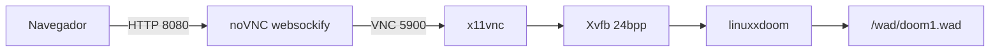

# DOOM (Linux source) + Docker + navegador

Código-fonte original do DOOM (id Software, release de 1997, GPL-2.0), com build e execução via Docker. O jeito mais fácil de jogar neste fork é pelo **navegador** (noVNC).

A nota histórica de John Carmack continua em [`README.TXT`](README.TXT).

## Análise rápida

| Peça | Papel |
| --- | --- |
| `linuxxdoom` | Engine original + patch **TrueColor** (cores corretas no browser) |
| `Xvfb` | Display virtual 24 bpp |
| `x11vnc` | Espelha o Xvfb em VNC (`:5900`) |
| `websockify` + `noVNC` | Expõe o VNC no browser em `http://localhost:8080` |
| `wad/doom1.wad` | IWAD (dados do jogo; não vai na imagem) |



## Estrutura

| Pasta | Conteúdo |
| --- | --- |
| `linuxdoom-1.10/` | Cliente Linux + X11 (`linuxxdoom`) |
| `sndserv/` | Servidor de som separado (`sndserver`) |
| `ipx/`, `sersrc/` | Drivers DOS de rede (fora do build Linux) |
| `wad/` | IWAD local (não versionado) |
| `scripts/` | Download do shareware `doom1.wad` |

## O que este fork adiciona

- `Dockerfile` multi-stage (Debian Bookworm), build **32-bit** (`-m32`)
- Patches só na imagem: `errno.h`, remoção de `values.h`, libs X11 modernas
- Patch TrueColor em `i_video.c` (paleta 8-bit → RGB no blit)
- Runtime com **Xvfb 24 bpp** + **x11vnc** + **noVNC**
- Entrypoint que monta o IWAD e sobe a stack (escala `-2` por padrão)
- Script para baixar o shareware legal `doom1.wad` (ibiblio, v1.8)

## Jogar no navegador

```powershell
# 1) IWAD (só na primeira vez)
powershell -ExecutionPolicy Bypass -File .\scripts\fetch-shareware-wad.ps1

# 2) Build
docker build -t linuxdoom:local .

# 3) Run (expõe noVNC)
docker run --rm -p 8080:8080 -v "${PWD}/wad:/wad:ro" linuxdoom:local
```

Abra: [http://localhost:8080/vnc.html?autoconnect=1&resize=scale](http://localhost:8080/vnc.html?autoconnect=1&resize=scale)

Clique na área do jogo para o teclado ir para o Doom (não para o noVNC).

Sem argumentos extras, o container inicia em **E1M1** (`-2 -skill 3 -warp 1 1`) para evitar demos do IWAD 1.8 (incompatíveis com o engine 1.10).

No Linux: `scripts/fetch-shareware-wad.sh`.

### Como jogar (controles padrão)

Bindings padrão do LinuxDoom (`m_misc.c` / teclado X11):

| Tecla | Ação |
| --- | --- |
| `↑` / `W` | Andar para frente |
| `↓` / `S` | Andar para trás |
| `←` / `→` | Girar |
| `A` / `,` | Strafe esquerda |
| `D` / `.` | Strafe direita |
| `Alt` | Segurar para strafe com as setas |
| `Shift` | Correr |
| `Ctrl` | Atirar |
| Mouse (horizontal) | Virar o personagem |
| Botão esquerdo do mouse | Atirar |
| Scroll do mouse | Trocar arma (próxima / anterior) |
| `Espaço` | Usar (abrir portas / interruptores) |
| `1`–`7` | Trocar arma |
| `Tab` | Mapa |
| `Esc` | Menu |
| `Enter` | Confirmar no menu |
| `Pause` | Pausar |
| `F1` | Ajuda |
| `F2` | Salvar |
| `F3` | Carregar |
| `F4` | Volume de som |
| `F5` | Detalhe gráfico |
| `F6` | Quick save |
| `F7` | Fim de jogo |
| `F8` | Mensagens |
| `F9` | Quick load |
| `F10` | Sair |
| `F11` | Gamma |
| `-` / `=` | Diminuir / aumentar tamanho da tela |

No noVNC, clique no canvas do jogo antes de jogar (para capturar teclado e mouse). `Ctrl` (atirar) não deve mais derrubar a sessão: o container ignora SIGPIPE e não sobe o `sndserver` OSS quebrado.

Mouse: movimento horizontal vira; botão esquerdo atira. Se o cursor “escapar”, clique de novo na janela do Doom.

Se o browser roubar atalhos (`Ctrl+W`, etc.), use o botão esquerdo do mouse para atirar.

## Limitações

- **Som**: desligado de propósito (sem `/dev/dsp`; evita crash ao atirar)
- **Latência**: VNC via browser; jogável, mas não é nativo
- **Demos**: IWAD shareware 1.8 ≠ engine 1.10
- Sem senha no VNC — use só em localhost

Se as cores aparecerem verdes/erradas, atualize a imagem (patch TrueColor) e use Xvfb 24 bpp — o PseudoColor 8-bit puro quebra no noVNC.

## Licença

- Código: GPL-2.0 — ver [`LICENSE.TXT`](LICENSE.TXT)
- IWAD comercial: propriedade da Bethesda/id; o script baixa apenas o **shareware** redistribuível
