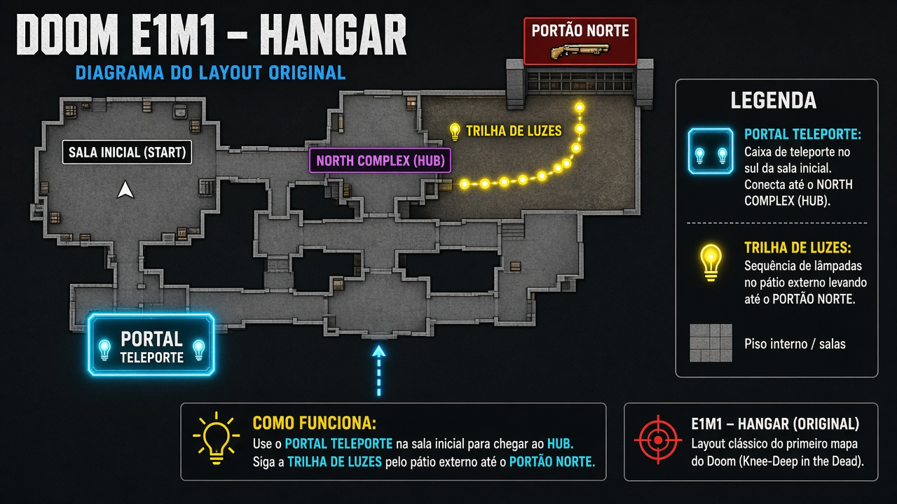
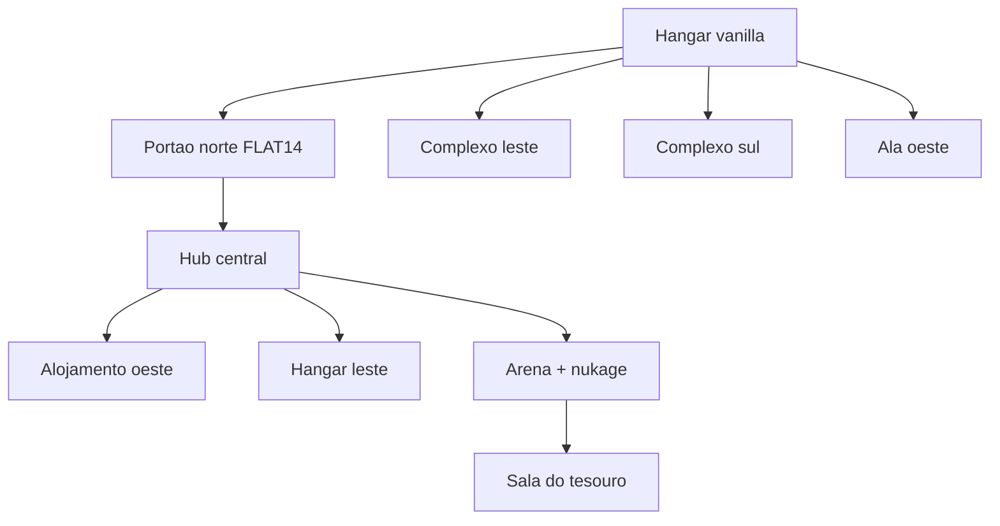

# E1M1 Hangar — antes e depois (~2×)

O Hangar vanilla permanece intacto. A diferença é **explícita**: uma abertura enorme (≈832 unidades) no pátio norte, com piso brilhante `FLAT14` e textura `BIGDOOR2`, leva a um complexo novo quase do tamanho do mapa original. Há também alas leste, sul e oeste.

## Números

| Métrica | Antes (vanilla) | Depois |
| --- | ---: | ---: |
| Setores | 85 | 111 |
| Things | 138 | ~371 |
| BBox X | -768 … 3808 | -2800 … 6800 |
| BBox Y | -4864 … -2048 | -7000 … 1600 |
| Área do bbox | ~1.0× | **~6×** (jogável ~2×+) |

## Como achar as áreas novas (não dá para confundir)

1. **Principal — Norte:** no pátio externo do Hangar, olhe a **parede norte longa**. Há um vão largo com piso claro (`FLAT14`) e portão `BIGDOOR2`. Entre e explore o hub, alojamentos, arena e pátio de nukage.
2. **Leste:** no outdoor elevado (chão 104), abertura com o mesmo piso claro → depósito / arsenal / anexos.
3. **Sul:** ponta sul do mapa → alojamento / nukage.
4. **Oeste:** área lateral → corredor e salas marrons.

## Fluxo

## Temas visuais (diferença explícita)

| Zona | Piso | Parede |
| --- | --- | --- |
| Entradas novas | `FLAT14` (claro) | `BIGDOOR2` |
| Hub / labs | `FLAT5_4` | `STARTAN3` / `STONE2` |
| Alojamento | `FLOOR7_1` | `BROWN1` / `BROWN96` |
| Nukage | `NUKAGE1` | `SLADWALL` |

Stats: [`maps/e1m1_stats.json`](../maps/e1m1_stats.json). Rebuild: `py maps\build_e1m1_expandido.py`.
